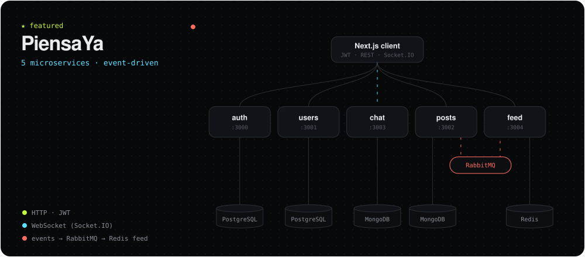

<div align="center">
  
</div>

<br />

### `$ cat about.ts`

```ts
const carlos = {
  role: "Backend Developer",
  focus: ["Software Architecture", "Microservices", "Event-Driven Systems"],
  building: "PiensaYa — a social network split into 5 services",
  basedIn: "Lima, Perú 🇵🇪",
  speaks: ["Español", "English"],
  nextLevel: "technical leadership",
};
```

### `$ ls ./stack`

| | |
|---|---|
| `languages` |  |
| `backend` |  |
| `databases` |  |
| `frontend` |  |
| `tools` |  |

<p>
  
  
  
  
  
  
  
  
  
  
  
</p>

### `$ ls ./projects`

<a href="https://github.com/andresklve/PiensaYa">
  
</a>

> **[PiensaYa](https://github.com/andresklve/PiensaYa)** — A social network for students built from 5 microservices (auth, users, posts, chat and feed), each with its own database. The feed updates in the background through RabbitMQ and Redis, and chat works in real time.
> <br /><sub>NestJS · TypeScript · Next.js · PostgreSQL · Prisma · MongoDB · Redis · RabbitMQ · Docker · WebSockets · JWT · Swagger · Jest</sub>

<table>
  <tr>
    <td width="50%" valign="top">
      <h4><a href="https://github.com/andresklve/report-and-be-hear-api">ReclamaYa</a> <sub><code>UPC project</code></sub></h4>
      An app for Peruvian citizens to report environmental problems and actually be heard. The backend is Spring Boot with PostgreSQL.
      <br /><br />
      <sub>Java · Spring Boot · Angular · TypeScript · PostgreSQL · REST APIs</sub>
    </td>
    <td width="50%" valign="top">
      <h4><a href="https://github.com/andresklve/PortafolioWeb">PortafolioWeb</a> <sub><code>this vibe, but as a site</code></sub></h4>
      My personal portfolio, built from scratch. Bilingual (ES/EN), with animations and live SVG architecture diagrams.
      <br /><br />
      <sub>Next.js · React · TypeScript · Tailwind CSS · Motion</sub>
    </td>
  </tr>
</table>

### `$ curl -s contact | jq`

<p>
  <a href="mailto:carlosandresig91@gmail.com"></a>
  <a href="https://www.linkedin.com/in/andresinfantass/"></a>
  <a href="https://wa.me/51946335410"></a>
</p>

<br />

<div align="center"><sub>❯ built from Lima, Perú · <code>exit 0</code></sub></div>
